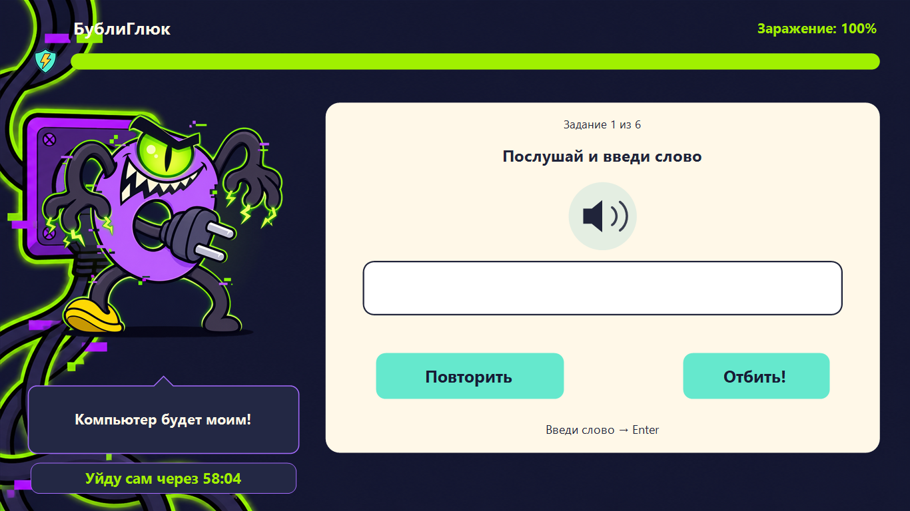
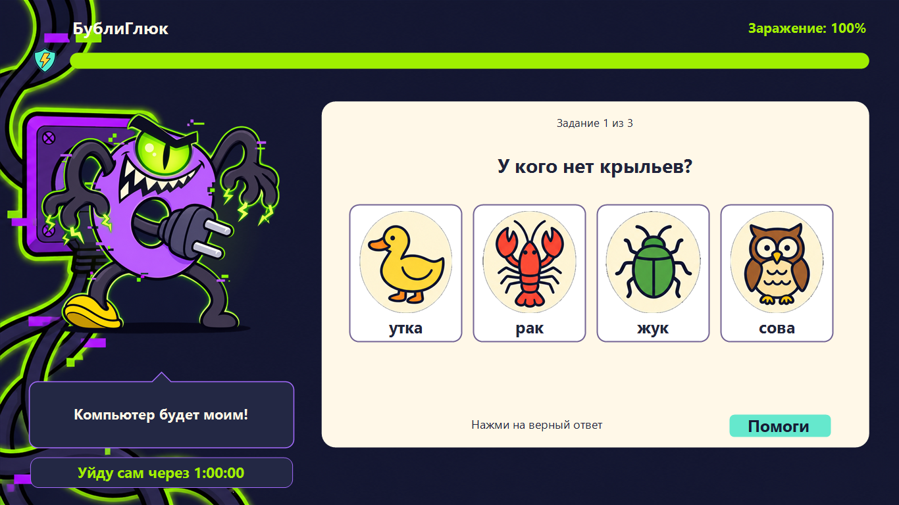

# Глюкобой

Бесплатная программа для Windows 10/11: раз в 15–20 минут БублиГлюк закрывает экран и выключает звук других приложений.
Ребёнок пишет два коротких диктанта, решает примеры и задания со словами или картинками, чтобы победить вирус. Всего 4–6 заданий за атаку.
Я написал её для своего сына Дани, который всё время смотрит видео на ноутбуке. В программе одна сложность: **1 класс, вторая четверть**.
Родитель не вмешивается: программа сама прерывает видео и усаживает за примеры. С вами ребёнок будет спорить, с БублиГлюком — никак.


[Страница программы](https://cinicmanager.github.io/glukoboy/) · [Скачать для Windows](https://github.com/Cinicmanager/glukoboy/releases/latest/download/Glukoboy.zip) · [Релизы](https://github.com/Cinicmanager/glukoboy/releases)

**Версия 1.7.2:** диктанты упрощены до одного слова из двух слогов. Исправлено восстановление звука приложений после атаки при пересоздании аудиосессии и временной ошибке устройства.

БублиГлюк произносит одно слово, а Даня вводит его целиком. В банке 20 простых слов по четыре буквы и два слога, в каждой атаке ровно два диктанта. Голос и паузы встроены в exe, интернет для игры не нужен.

## Установка и автозапуск

1. Скачайте `Glukoboy.zip`, распакуйте в отдельную папку и запустите `Glukoboy.exe`. В архиве также `Обновить.cmd`, `update.ps1`, `Включить автозапуск.cmd` и `startup.ps1`. Установка не нужна, используется встроенный .NET Framework 4.
2. Отсутствующий `settings.ini` программа создаст сама. Все задания, картинки и голос уже встроены в exe.
3. При желании измените расписание и число заданий в `settings.ini`, затем перезапустите программу. Выбирать класс или уровень не нужно.
4. Для автозапуска один раз запустите **`Включить автозапуск.cmd`** из папки программы под учётной записью ребёнка. Скрипт создаёт ярлык для текущего пользователя; права администратора не нужны. При следующем входе в Windows Глюкобой запустится сам.

После ручного обновления оба файла автозапуска появляются рядом с exe при его запуске. Само обновление автозапуск не включает. Повторный запуск скрипта не создаёт второй ярлык. Если перенесёте папку программы, запустите скрипт снова: он обновит путь и сохранит прежний ярлык в `.bak`. Для отключения откройте **Win+R → `shell:startup`** и удалите `Glukoboy.lnk`.

**Переход с «Бубликлюка» (`Bubliklyuk.exe`):** выйдите через **Ctrl+Alt+Q**, удалите старый ярлык из автозагрузки, положите `Glukoboy.exe` в выбранную папку. Запустите его и создайте новый ярлык для автозапуска.

## Что внутри

Верный ответ бьёт вирус: снаряды, искры, звёздочки, «+1», «Два подряд!» и добивающий удар. Ошибка не наказывает — контратаку отбивает щит, вирус хихикает, а карточка качается. Пока ребёнок печатает ответ, вирус задумывается, а новое задание въезжает сбоку.

| Заданий за атаку | Состав |
| --- | --- |
| 4 | Два диктанта, одна математика, сборка слова или карточка выбора |
| 5 | Два диктанта, одна математика, сборка слова и карточка выбора |
| 6 | Два диктанта, две математики, сборка слова и карточка выбора |

БублиГлюк появляется по-разному, подпрыгивает пружинкой, крутится и теряет тапок. В финале улетает на шарике, уезжает на тележке или прячется за щитом. Появления и финалы чередуются. Во время задания движения спокойные; `AnimationLevel=0` оставляет минимум движения, `1` — обычную анимацию, `2` — более активную.

### 20 диктантов

В каждом диктанте одно слово из двух слогов. На экране только инструкция **«Послушай и введи слово»**, значок динамика и поле ввода; готовый ответ не показывается.

Банк: мама, папа, каша, ваза, рама, луна, рыба, рука, нога, сова, лиса, коза, вода, роза, муха, мыло, сани, лето, небо, липа.

Перед первым диктантом атаки БублиГлюк один раз говорит: **«Даня, привет. Я Бублиглюк. Попробуй ввести, что я говорю.»** Затем произносит текущее слово целиком и повторяет его до правильного ответа, выдерживая пять секунд после каждого произнесения. Кнопка **«Повторить»** начинает слово заново без вступления. Второй диктант той же атаки тоже начинается без приветствия.

Голос Windows Irina записан заранее. WAV-файлы с паузами встроены в exe: устанавливать голос или подключаться к сети не нужно. Во время атаки выключен звук сессий других приложений, а голос Глюкобоя слышен. При правильном ответе, смене задания или закрытии окна речь сразу прекращается.

После закрытия атаки восстанавливается прежний звук приложений. Если устройство временно не отвечает, программа сохраняет исходное состояние и повторяет восстановление. Звук, выключенный пользователем до атаки, остаётся выключенным.

После ошибки остаются введённый текст и то же задание: можно исправить ответ, слушая повтор. Сообщение — «Послушай ещё раз». Две ошибки диктант не заменяют. Проверка принимает разный регистр, пробелы по краям, конечную точку и замену ё/е.



### 60 карточек с выбором ответа

Задания со словами и картинками включают сборку слова из слогов и интерактивные карточки:

- 30 — «Какой предмет лишний?» с указанным признаком: «Что нельзя есть или пить?», «У кого нет крыльев?», «Кто не живёт в воде?»;
- 15 — выбор предмета по описанию;
- 15 — продолжение последовательности фигур или чисел в пределах 10.

Нажмите одну из четырёх больших картинок или кнопок. После первой ошибки варианты остаются на месте. **После второй ошибки только эта карточка заменяется другой того же типа, без зачёта.** Уже решённые задания сохраняются, позиция верного ответа меняется. Быстрые повторные нажатия игнорируются. Банк избегает повторения последних 12 карточек. В заданиях с вводом слова или числа можно исправлять ответ на той же карточке сколько угодно.

Кнопка **«Помоги»** даёт подсказку без штрафа. Карточки выбора встроены в exe. У диктанта вместо подсказки есть кнопка **«Повторить»**.

**«Собери слово» — это 30 слов из трёх слогов, не больше шести букв**: `со + ба + ка`, `мо + ло + ко`, `ра + ке + та`. Обычное сложение — три числа от 1 до 3, например `1 + 2 + 3 = □`; сумма укладывается в `MathMax`. Вычитание и пропущенное число работают по прежним правилам. У задач с текстом 12 тем: сад, книги, автобус, утки, рисунки, поезд, цветы, посуда, кубики, пекарня, рыбалка и лес. Они решаются одним действием.



С 21:00 до 07:00 — один из четырёх ночных сюжетов, без заданий и звука: **перегрев, ремонт после сбоя, очистка от глюков или большое обновление**. БублиГлюк занимается компьютером сам и показывает, когда снова можно пользоваться. Это игровые истории: программа не проверяет температуру, не ремонтирует Windows и не устанавливает системные обновления.

При запуске программа сверяет время Windows с расписанием. Если сейчас ночь, она сразу включает ночной экран. Повторный запуск уже работающей копии также возвращает ночной режим в пределах секунды; скрытое или свёрнутое окно восстанавливается автоматически. Старый файл `night-state.txt` больше не отменяет ночь. Родительский пропуск через Ctrl+Alt+N действует только до утра либо до следующего запуска Глюкобоя.

Сюжеты чередуются по датам, не повторяются две ночи подряд и не меняются после полуночи или перезапуска. `NightModes=overheat` оставляет только прежний перегрев; список `overheat,repair,cleanup,update` включает все четыре. Первые 20 секунд движения заметнее, затем анимация становится реже. За пять минут появляется предупреждение; время настраивается.

**Последние 15 минут перед ночью — без новых атак:** при стандартном расписании с 20:45 до 21:00. Ограничение действует для таймера, Ctrl+Alt+B, перезапуска и TestMode. Атака, начавшаяся раньше 20:45, может продолжаться. В 20:55 остаётся короткое предупреждение, в 21:00 начинается ночной режим. При изменении `NightFrom` этот перерыв сдвигается вместе с началом ночи.

С 07:00 до 09:00 — свободное утро: компьютер работает как обычно, атак по таймеру нет, чтобы спокойно собраться в школу. Первая атака — через 15–20 минут после 09:00. Ctrl+Alt+B в это время работает.

По будням с 08:20 до 09:00 — экран «Пора в школу!» с обратным отсчётом, без атак и звука. Если в школу сегодня не надо (каникулы, болеет), нажмите внизу «Сегодня не надо в школу» и решите пример вида 64 × 83: экран уйдёт до конца окна, отметка хранится в school-state.txt.

Атака уходит сама, если её час никто не трогает: ни клавиатуру, ни мышь. Слева под репликой вируса идёт таймер «Уйду сам через 59:41», любое касание сбрасывает его. У ребёнка выбор: решить задания или отойти от ноутбука на час. После ухода следующая атака ждёт, пока кто-нибудь тронет компьютер, и приходит через обычный интервал — так вирус не встречает ребёнка из школы.

## Клавиши родителя

| Сочетание | Действие |
| --- | --- |
| Ctrl+Alt+B | Атака сейчас; ночью, за 15 минут до ночи, в «Пора в школу» и во время атаки игнорируется |
| Ctrl+Alt+Q | Вернуть прежнее состояние звука и полностью выйти |
| Ctrl+Shift+F12 | Запасной полный выход; на ноутбуке может потребоваться Fn |
| Ctrl+Alt+N | Пропустить текущую ночь до утра либо до нового/повторного запуска Глюкобоя |

Сочетания работают и в русской раскладке. Дневную атаку также закрывает **Alt+F4**: звук возвращается, цикл начинается заново. Ночной экран это сочетание не закрывает.

## Настройки settings.ini

Файл лежит рядом с exe. После правок перезапустите программу.

| Ключ | По умолчанию | Значения и назначение |
| --- | --- | --- |
| IntervalMin | 15 | Нижняя граница случайного интервала после атаки, 1–1440 минут |
| IntervalMax | 20 | Верхняя граница интервала, 1–1440 минут; не меньше IntervalMin |
| TaskMin | 4 | Минимум заданий: от 4 до 6 |
| TaskMax | 6 | Максимум заданий: от 4 до 6, не меньше TaskMin; можно зафиксировать 4/4, 5/5 или 6/6 |
| MathMax | 10 | Предел математики: 3–10; шаги 1–3 |
| NightFrom | 21:00 | Начало ночи по времени Windows, формат ЧЧ:ММ |
| NightTo | 07:00 | Конец ночи по времени Windows, формат ЧЧ:ММ |
| FreeFrom | 07:00 | Начало свободного утра без атак, формат ЧЧ:ММ |
| FreeTo | 09:00 | Конец свободного утра; одинаковые FreeFrom и FreeTo — выключить |
| SchoolFrom | 08:20 | Начало экрана «Пора в школу», формат ЧЧ:ММ |
| SchoolTo | 09:00 | Конец экрана «Пора в школу»; одинаковые SchoolFrom и SchoolTo — выключить |
| SchoolDays | 12345 | Дни недели цифрами: 1 — понедельник … 7 — воскресенье |
| IdleLeave | 60 | Через сколько минут без клавиатуры и мыши атака уходит сама; 0 — выключить |
| NightModes | overheat,repair,cleanup,update | Ночные сюжеты через запятую. Можно оставить только overheat (перегрев) или выбрать любые из четырёх |
| AnimationLevel | 1 | 0 — минимум движения, 1 — обычная анимация, 2 — активная |
| TestMode | 0 | 1 — первая дневная атака через 10 секунд, следующие через минуту; ночь и свободное утро продолжают действовать |

## Переход с прежних версий

Доступна только сложность «1 класс, вторая четверть». Старые ключи `Grade` и `Level` игнорируются; удалять их вручную необязательно. Код других классов и уровней, прежние банки чтения и их формат сохранены в черновиках `drafts/legacy-1.6.4/` и недоступны в текущей игре.

Старые диапазоны числа заданий 3/4 и 4/5 означают новый диапазон 4–6. Явно заданные 4/4, 5/5 и 6/6 сохраняются. Изменения применяются в памяти: существующий `settings.ini` не перезаписывается.

`tasks.txt` больше не читается и не создаётся. Если рядом с exe остался ваш старый файл, программа его не изменяет и не удаляет. Все действующие задания встроены в exe.

## Обновление

Сама программа в интернет не ходит. Чтобы обновить её, запустите `Обновить.cmd` из папки с программой. Скрипт:

- сверяет версию `Glukoboy.exe` с последним релизом на GitHub;
- если есть новая, скачивает `Glukoboy.exe` и проверяет SHA-256 и заголовок MZ;
- просит закрыть Глюкобой через **Ctrl+Alt+Q**, подменяет файл (при ошибке возвращает старый) и запускает новую версию.

`settings.ini` и существующие личные файлы сохраняются; старый `tasks.txt` больше не используется. После запуска новой версии действует текущее расписание, даже если до обновления ночь была пропущена. Нужен интернет, файл должен называться ровно `Glukoboy.exe`, папка должна быть доступна на запись: обычная папка подойдёт, `Program Files` — нет.

Версии 1.0.x обновлялись сами изнутри exe. С 1.1.0 программа в интернет не ходит, обновление вынесено в отдельный скрипт. Если в папке остался `update.log` от 1.0.x, его можно удалить.

В версиях 1.0.0–1.1.0 окно атаки мелькало и сразу закрывалось. Исправлено в 1.1.1: ставьте её или новее.

Ошибки программы пишутся в `errors.log` рядом с exe.

## Сборка из исходников

Запустите `build.cmd` из корня репозитория. Скрипт использует встроенный `csc.exe` из .NET Framework 4: сначала Framework64, затем Framework. Собирает `src/*.cs`, подключает `System.Windows.Forms.dll` и `System.Drawing.dll`, встраивает PNG-картинки и WAV-записи из `resources/`, а также CMD-файлы и `startup.ps1` из `src/` под именами файлов.

Результат — `Glukoboy.exe` в корне. Начальный `settings.ini` копируется из `src/`, только если рядом с exe его ещё нет. `tasks.txt` не создаётся. Архив для установки содержит exe, ручной обновлятор и оба файла автозапуска, без настроек и банка заданий. Код ошибки компилятора передаётся наружу.

Проверки: `powershell -NoProfile -ExecutionPolicy Bypass -File tests/run.ps1`. Они собирают отдельную программу во временной папке, проверяют банки, диктанты и паузы WAV, обработку ошибок, состав атак из 4–6 заданий, ночное расписание и старые настройки. Проверяют доставку скриптов из exe и создание, повторное включение и перенос ярлыка в отдельной тестовой папке. Там же сохраняются изображения экранов 1024×768, 1366×768 и 1920×1080. Игровой процесс не запускается, настоящая автозагрузка, звук и фокус рабочего стола не меняются.

## Структура репозитория

```text
src/               C#, исходный settings.ini, скрипты обновления и автозапуска
resources/         PNG-картинки и WAV-записи голоса
drafts/legacy-1.6.4/ прежние уровни, банки чтения и исходники
docs/              index.html и img/
build.cmd          сборка
README.md, LICENSE, .gitignore — документация, лицензия и исключения Git
```

## Честно

Функций родительского контроля и защиты здесь нет: ребёнок, знакомый с диспетчером задач, закроет программу. Это игра, которая отвлекает от экрана и заставляет порешать примеры — почти как домашка.

Exe не подписан. SmartScreen может предупредить о запуске; если доверяете файлу, выберите **«Подробнее → Выполнить в любом случае»**. Исходники открыты, сборка доступна через встроенный `csc.exe`.

## Лицензия

[MIT](LICENSE). Copyright (c) 2026 Cinicmanager.
